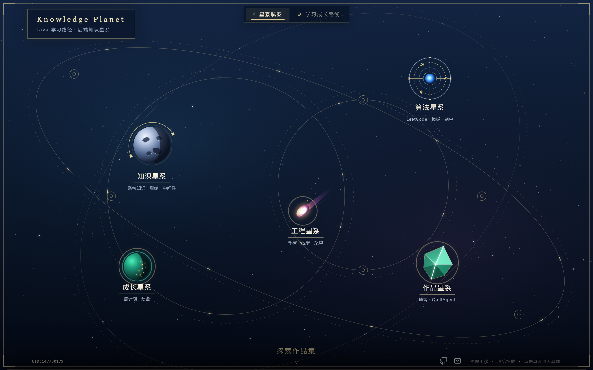
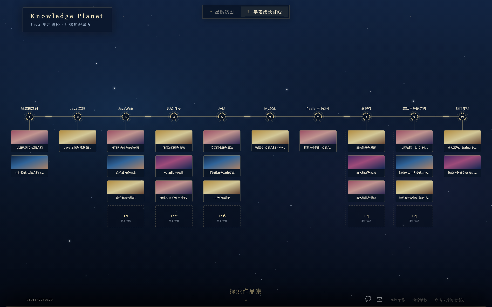
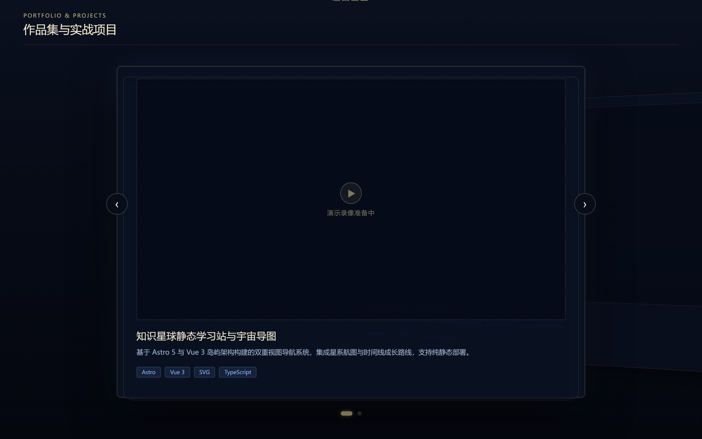
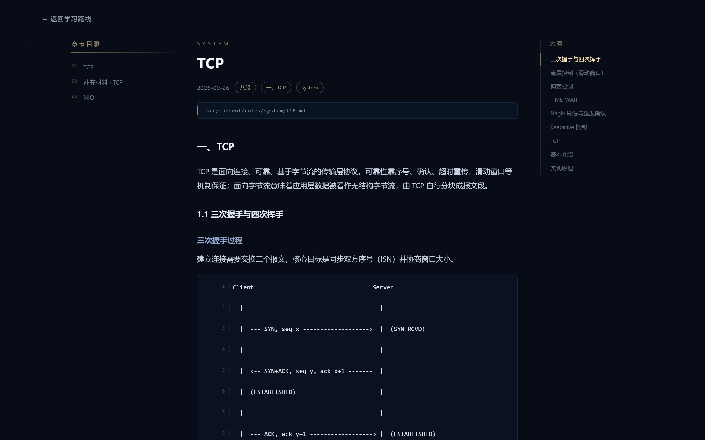

# Knowledge Planet · 知识星球

一个以「宇宙 / 星系」为视觉语言的学习笔记与作品集静态站点。基于 **Astro 5 + Vue 3**，全部内容预渲染为静态页面，可直接部署到任意静态托管。

**线上地址：<https://lgtplanet.cn/>**

- 首页：星系航图（宇宙总览）+ 学习成长路线（时间线）+ 作品集层
- 中间层：星系详情页，按模块列出星球与笔记
- 内容层：深空风格阅读页，左侧章节目录、右侧大纲、正文 Markdown 渲染

## 预览

### 星系航图



### 学习成长路线



### 作品集层



### 阅读页



### 移动端


## 技术栈

| 类别 | 选型 |
| --- | --- |
| 框架 | Astro 5（静态输出 + 岛屿架构） |
| 交互组件 | Vue 3 `<script setup>`，通过 `@astrojs/vue` 挂载 |
| 图形 | 原生 SVG（轨道、星球、连线、粒子），未使用 Canvas 或图形库 |
| 内容 | Astro Content Collections（`glob` loader + Markdown） |
| 代码高亮 | Shiki（`github-dark`，自定义行号转换器） |
| 动画 | CSS keyframes / transform / opacity + 少量 `requestAnimationFrame` |
| 测试 | Python Playwright（桌面 1440×900、移动端 390×844） |

## 快速开始

```bash
npm install
npm run dev      # 本地开发，默认 http://localhost:4321
npm run build    # 生成静态产物到 dist/
npm run preview  # 预览构建结果
```

## 目录结构

```
src/
├── components/
│   ├── UniverseHome.vue     # 首页外壳：双 Tab、双屏滚动、作品集层
│   ├── StarMap.vue          # 星系航图：SVG 星系、轨道、粒子、拖拽缩放
│   ├── FateMap.vue          # 学习成长路线：10 阶段时间线与知识卡片
│   ├── HudTitle.vue         # 左上角 HUD 标题
│   └── SocialLinks.vue      # 右下角 GitHub / 邮箱图标
├── composables/
│   └── usePanZoom.js        # 拖拽平移 + 滚轮缩放（指针锚点、rAF 合并）
├── data/
│   ├── galaxies.js          # 星系元信息与星球映射
│   ├── docs.js              # 文档路由标题映射
│   └── nodes.js             # 旧版星球 / 路线数据
├── content/
│   └── notes/               # 全部笔记，按模块分文件夹
│       ├── algorithm/       # 算法与数据结构
│       ├── system/          # 计算机基础、Java、数据库、框架中间件
│       ├── blog-dev/        # 博客系统开发与部署记录
│       ├── projects/        # 项目文档（博客、QuillAgent 等）
│       └── growth/          # 学习计划、复盘、求职记录
├── layouts/
│   └── Base.astro           # HTML 骨架、全局变量与基础排版
└── pages/
    ├── index.astro                        # 首页
    ├── galaxy/[slug].astro                # 星系详情（列表 + 星球卡）
    ├── planet/[planet]/[...slug].astro    # 笔记阅读页（三栏布局）
    └── docs/[...slug].astro               # 阅读页占位路由
```

## 页面与路由

| 路由 | 说明 |
| --- | --- |
| `/` | 星图首页；`?view=fate` 直接打开学习路线 |
| `/galaxy/{id}` | 星系详情，目前以卡片网格展示该星系下的模块 |
| `/planet/{planet}/{slug}` | 笔记正文页，章节目录 + 大纲 + Markdown |
| `/docs/{slug}` | 旧版阅读占位页 |

## 笔记规范

每篇笔记使用统一的 frontmatter：

```yaml
---
title: "TCP"
date: 2026-09-26
planet: system          # algorithm | system | blog-dev | projects | growth
galaxy: knowledge       # 可选，星系归属
tags: ["网络", "传输层"]
summary: "TCP 连接管理与可靠传输"
private: false          # true 时不会生成页面
---
```

- `planet` 必须与所在文件夹一致，否则前端分类会错位。
- 标题建议写完整语义，时间线卡片会直接展示。
- 内容支持标准 Markdown；代码块自动带行号与深色高亮。

## 主要特性

**星系航图**
- 5 个星系节点：成长、知识、工程、算法、作品。
- 静态轨道 + 星系呼吸光晕 + 缓慢自转 + 背景星点视差。
- 悬浮星系显示「星系档案」面板：文档数量与前 3 篇文档。
- 桌面支持拖拽平移与滚轮缩放（0.6–2.2 倍），移动端自动适配横屏。

**学习成长路线**
- 横向时间轴，10 个阶段节点：计算机基础 → Java 基础 → JavaWeb → JUC → JVM → MySQL → Redis 与中间件 → 微服务 → 算法 → 项目实战。
- 每个节点下挂载真实笔记卡片，超出部分折叠为「+N 更多笔记」。
- 卡片标题、链接均来自内容集合，不写死。

**阅读页**
- 三栏布局：左侧章节目录、中间正文、右侧小节大纲。
- 目录与大纲随滚动定位，标题、日期、标签、文件路径提示完整展示。
- 代码块行号、引用块、表格均适配深色主题。

**作品集层**
- 首页上拉覆盖式展示，3D 叠层轮播，支持箭头、圆点与滑动切换。
- 预留 16:9 演示录像区域，便于后续接入录屏。

**可访问性与性能**
- 支持 `prefers-reduced-motion`，开启后停止呼吸、粒子、流星等动画。
- 动画仅使用 `transform` / `opacity`，避免布局重排。
- 星空背景为固定层，拖拽缩放时不会露出画布边界。

## 部署

静态产物无运行时依赖，推荐 Cloudflare Pages：

- Framework preset：`Astro`
- Build command：`npm run build`
- Output directory：`dist`
- Node：`20`

绑定自定义域名后，请同步修改 `astro.config.mjs` 中的 `site` 字段。

## 已知限制

- 笔记文件名含中文，URL 会被编码为 `%E8%AE%A1...`，暂未做英文 slug。
- `/galaxy/{id}` 目前为卡片网格，尚未实现「星系内静止太阳系」视图。
- `/docs/{slug}` 为旧版占位页，内容以 `/planet/...` 为准。
- 博客后端已下线，作品集内仅保留项目说明与演示位。
